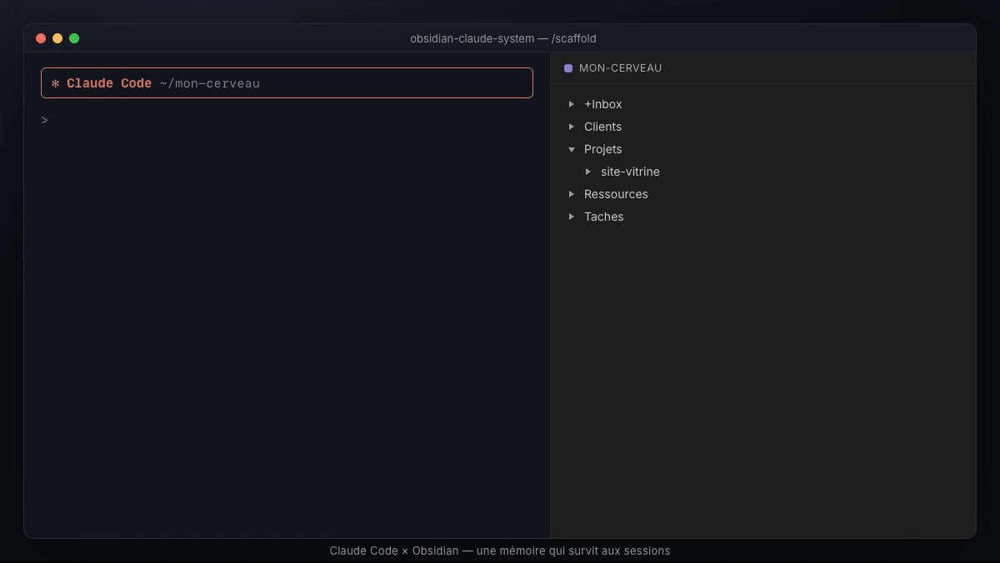

# obsidian-claude-system

[](https://github.com/AdChaine/obsidian-claude-system/actions/workflows/validate.yml)
[](LICENSE)

Un **système de mémoire persistante** pour [Claude Code](https://claude.com/claude-code), bâti sur un vault [Obsidian](https://obsidian.md). Transforme Claude Code en assistant qui **se souvient de vos clients, projets et décisions** d'une session à l'autre — sans tout réexpliquer à chaque fois.

> Gouvernance déterministe (commandes XML), sécurité (« zéro secret »), efficience (chasse aux tokens). Markdown pur côté vault, structure XML côté commandes.

<p align="center"></p>

---

## Ce que ça fait

- **`/resume`** — reprend le contexte d'un client/projet en 30 s, en ne chargeant que les fichiers utiles (chasse aux tokens).
- **`/client-brief`** — synthèse fidèle d'un client (RAG strict : interdiction d'inventer, mentions « — (non documenté) » sur les trous).
- **`/compress`** — sauvegarde la session (log daté + mise à jour du vault), avec contrôle anti-secret et alerte d'« obésité » des fichiers.
- **`/preserve`** — ancre une décision permanente dans le « Cerveau Maître » via une ancre déterministe `<!-- LEARNINGS -->`, avec validation humaine (diff avant écriture).
- **`/scaffold`** — initialise une nouvelle entité (repo de code, projet vault ou client vault) : demande le type + le nom, route vers le bon dossier, et hydrate chaque fichier avec son gabarit (jamais de note vide).
- **`/audit-vault`** — traque les candidats aux notes orphelines via un script `grep` en une passe (POSIX universel, ~0,02 s sur des centaines de notes), exclut les racines et les logs de session, et écrit un backlog actionnable dans `+Inbox/TODO-liens.md`.
- **`/lint-vault`** — contrôle d'intégrité du schéma en une passe `grep`/`awk` (POSIX, lecture seule) : vocabulaire fermé de `type:` et `status:`, frontmatter manquant, gros fichiers sans sommaire, orphelins, fichiers parasites. Sort en code 1 si le schéma est violé, donc utilisable en **hook `pre-commit`** : la dérive est bloquée à l'écriture, pas découverte six mois plus tard.
- **Skill `obsidian-note-system`** — la gouvernance : 8 types de notes, règle « 0 note orpheline », palette emoji fermée, limite 300 lignes, règle de sécurité « zéro secret ».

> Chaque commande est un **skill** : elle se lance avec `/nom` dans Claude Code, et Claude la déclenche aussi tout seul quand la demande correspond (« on reprend le client X » → `/resume`). Le vault est détecté automatiquement (dossier de travail ou dossier partagé), ou demandé une fois.

---

## Où l'utiliser

| Application | Compatible | Installation |
|---|---|---|
| **Claude Code** (terminal, VS Code, JetBrains) | Oui | Plugin en une ligne, ou `install.sh` / `install.ps1` |
| **Claude Desktop, onglet Code** | Oui | Comme Claude Code (c'est le même moteur) |
| **Claude Desktop, Cowork** | Oui | Importer `obsidian-memory.plugin`, puis partager le dossier du vault |
| **Claude Desktop, mode chat** | Oui, sans shell | Importer les skills (zips) + un serveur MCP de fichiers vers le vault |

**Installation express (Claude Code, onglet Code de Desktop) :**
```
/plugin install obsidian-memory --marketplace AdChaine/obsidian-claude-system
```
Les skills s'appellent alors `/obsidian-memory:resume`, `/obsidian-memory:compress`, etc. Pour des noms courts (`/resume`), utilisez plutôt le script d'installation ci-dessous.

Cowork et mode chat : guide pas à pas dans **[docs/claude-desktop.md](docs/claude-desktop.md)**. Les paquets (`.plugin` et zips de skills) sont attachés à chaque [release](https://github.com/AdChaine/obsidian-claude-system/releases/latest).

---

## Principes de conception

| Principe | Concrètement |
|---|---|
| **XML pour la gouvernance, Markdown pour les données** | Les skills-commandes (`skills/*/SKILL.md`) sont structurées en XML (standard Anthropic, meilleure adhérence). Vos notes restent du Markdown lisible. |
| **Human-in-the-loop** | Toute écriture dans le Cerveau Maître affiche un diff et attend confirmation. |
| **Zéro secret** | Aucune valeur sensible dans le vault. On référence le nom d'une variable (`API_KEY`), jamais sa valeur. C'est avant tout une **règle de gouvernance** (appliquée par `/compress` et le skill) ; la barrière technique complémentaire est le `.gitignore` du vault (et, si besoin, une règle `permissions.deny` dans `.claude/settings.json`). Pas de filtre magique de lecture IA. |
| **Chasse aux tokens** | Le bloc « Session courante » du MAP dit exactement quoi charger. On ne charge jamais tout un projet. |
| **0 note orpheline** | Toute note a au moins un lien entrant depuis un MAP ou un BRIEF. |
| **Vocabulaire fermé** | `type:` et `status:` n'acceptent qu'une liste finie de valeurs. Une nuance va dans `nature:`, `etat:` ou `priorite:` — jamais en inventant une valeur. Un schéma qui accepte tout n'indexe rien. |
| **La règle est exécutable** | Toute règle de gouvernance qui n'est pas vérifiée par un script finit violée. `/lint-vault` + hook `pre-commit` transforment les règles de la skill en contrainte machine. |
| **Ancres uniques** | Ne jamais réécrire la syntaxe exacte d'une balise (`LEARNINGS`, `TACHES-ACTIVES`) dans de la prose : les commandes matchent la première occurrence et écrivent au mauvais endroit. |

> ⚠️ Honnêteté technique : l'XML est un **harnais**, pas un compilateur. Il réduit fortement la dérive d'un LLM, il ne la supprime pas. Aucune commande n'est « déterministe » au sens programmatique.

---

## Installation

> **Bienvenue, même si c'est la première fois.** Ce guide est écrit pour quelqu'un qui n'a jamais touché à GitHub, au terminal ou à un outil IA. Chaque terme technique est expliqué quand il apparaît.

---

### Ce que tu vas installer

Trois outils sont nécessaires. Voici ce que chacun fait, en une phrase :

| Outil | Ce que c'est | Coût |
|---|---|---|
| **Obsidian** | Une application de notes sur ton ordinateur (comme Notion, mais hors ligne) | Gratuit |
| **Claude Code** | L'assistant IA d'Anthropic — comme ChatGPT, mais dans ton terminal | Abonnement Claude Pro requis |
| **Git** | Un outil qui télécharge des projets depuis GitHub sur ton ordinateur | Gratuit |

---

### Étape 1 — Installe Obsidian

1. Va sur [obsidian.md](https://obsidian.md)
2. Clique sur **"Download"**
3. Installe l'application comme n'importe quel logiciel (double-clic sur le fichier téléchargé)

---

### Étape 2 — Installe Claude Code

1. Va sur [claude.ai/code](https://claude.ai/code)
2. Suis le guide d'installation officiel
3. Un compte Anthropic est nécessaire — crée-en un gratuitement, puis souscris à Claude Pro

---

### Étape 3 — Ouvre la console de ton ordinateur

La **console** est une fenêtre où tu tapes des instructions texte. C'est par là que passe l'installation.

**Sur Mac :**
1. Appuie sur `Cmd ⌘ + Espace`
2. Tape `Terminal`
3. Appuie sur `Entrée`

**Sur Windows :**
1. Appuie sur `Windows + S`
2. Tape `PowerShell`
3. Clique sur **"Windows PowerShell"**

**Sur Linux :**
Cherche **"Terminal"** dans tes applications.

> La console affiche une ligne clignotante qui attend que tu tapes quelque chose. C'est normal.

---

### Étape 4 — Télécharge ce projet

**Option A — Avec Git (recommandé) :**

Vérifie si Git est déjà installé en tapant dans ta console :
```
git --version
```

- Si tu vois un numéro de version → Git est installé, continue.
- Si tu vois une erreur → installe Git :
  - **Mac** : macOS propose de l'installer automatiquement, accepte.
  - **Windows** : télécharge [Git for Windows](https://git-scm.com/download/win) et installe-le.
  - **Linux** : tape `sudo apt install git` (Ubuntu) ou `sudo dnf install git` (Fedora).

Puis télécharge le projet :
```
git clone https://github.com/AdChaine/obsidian-claude-system.git
```

> **`git clone`** = "télécharge une copie de ce projet sur mon ordinateur". Un dossier `obsidian-claude-system` est créé dans ton dossier personnel.

**Option B — Sans Git (téléchargement ZIP) :**
1. En haut de cette page GitHub, clique sur le bouton vert **"Code"**
2. Clique sur **"Download ZIP"**
3. Dézippe le fichier (double-clic sur le ZIP)
4. Place le dossier dézippé sur ton Bureau

---

### Étape 5 — Entre dans le dossier téléchargé

La commande `cd` ("change directory") te déplace dans un dossier.

**Mac / Linux :**
```bash
cd obsidian-claude-system
```

**Windows (PowerShell) :**
```powershell
cd obsidian-claude-system
```

Si tu as téléchargé le ZIP et placé le dossier sur le Bureau :

**Mac :**
```bash
cd ~/Desktop/obsidian-claude-system
```

**Windows (PowerShell) :**
```powershell
cd $env:USERPROFILE\Desktop\obsidian-claude-system
```

> **Comment savoir où tu es ?** Tape `pwd` dans ta console et appuie sur `Entrée` — ça affiche ton emplacement.

---

### Étape 6 — Lance l'installation

Remplace `mon-cerveau` par le nom que tu veux donner à ton vault (sans espaces, sans accents de préférence).

**Sur Mac ou Linux :**
```bash
./install.sh "$HOME/Documents/mon-cerveau"
```

Si tu vois `permission denied`, tape d'abord ceci puis relance la commande :
```bash
chmod +x install.sh
```

**Sur Windows (PowerShell) :**
```powershell
.\install.ps1 -VaultPath "$env:USERPROFILE\Documents\mon-cerveau"
```

Si PowerShell affiche une erreur de sécurité, tape d'abord ceci (autorise les scripts locaux une seule fois) :
```powershell
Set-ExecutionPolicy -ExecutionPolicy RemoteSigned -Scope CurrentUser
```
Puis relance la commande d'installation.

**Dans les deux cas, tu dois voir s'afficher :**
```
-> Installation depuis : /ton/chemin/obsidian-claude-system
  [OK] skill audit-vault installe
  [OK] skill client-brief installe
  [OK] skill compress installe
  [OK] skill lint-vault installe
  [OK] skill obsidian-note-system installe
  [OK] skill preserve installe
  [OK] skill resume installe
  [OK] skill scaffold installe
  [OK] chemin du vault fixe : .../Documents/mon-cerveau
Installation terminee.
```

Si tu vois ce message, l'installation est réussie.

---

### Étape 7 — Ouvre ton vault dans Obsidian

Le dossier `vault-template/` est le squelette de ton vault (= ton espace de notes pour Claude).

1. Ouvre **Obsidian**
2. Sur l'écran d'accueil, clique sur **"Ouvrir un dossier comme vault"**
3. Navigue jusqu'au dossier `vault-template/` (situé dans `obsidian-claude-system/vault-template/`)
4. Clique sur **"Ouvrir"**

Tu verras apparaître dans Obsidian les dossiers `Clients/`, `Projets/`, `Entreprise/`, `+Inbox/` et `Sessions/`.

> Tu peux renommer et déplacer ce dossier où tu veux — l'important est de noter le chemin exact pour plus tard.

---

### Étape 8 — Personnalise CLAUDE.md

Dans Obsidian, ouvre le fichier **`CLAUDE.md`** à la racine du vault. C'est le "cerveau" de Claude : il lui explique qui tu es, ce que tu fais, tes règles.

Remplis au minimum :
- **Qui je suis** → ton métier, ton contexte (ex : "designer indépendante, 3 clients actifs")
- **Mes priorités** → ce qui compte le plus pour toi en ce moment
- **Mes règles** → ce que Claude doit toujours faire ou ne jamais faire

---

### Étape 9 — Premier test

Ouvre **Claude Code** dans ton Terminal (tape `claude` et appuie sur `Entrée`), puis tape :

```
/resume
```

Claude doit te demander quel client ou projet reprendre. Si tu vois cette question, **tout fonctionne**.

> À la première utilisation de `/audit-vault` ou `/scaffold`, Claude Code te demandera l'autorisation d'exécuter des commandes locales. Réponds **`y`** (yes) pour approuver.

---

### En cas de problème

| Problème | Plateforme | Solution |
|---|---|---|
| `/resume` n'est pas reconnu dans Claude | Mac/Linux | Tape `ls ~/.claude/skills/` — vérifie que le dossier `resume` est présent |
| `/resume` n'est pas reconnu dans Claude | Windows | Tape `dir $env:USERPROFILE\.claude\skills\` — vérifie que le dossier `resume` est présent |
| `permission denied` sur `install.sh` | Mac/Linux | Tape `chmod +x install.sh` puis relance |
| Erreur de sécurité sur `install.ps1` | Windows | Tape `Set-ExecutionPolicy RemoteSigned -Scope CurrentUser` puis relance |
| Obsidian ne voit aucune note | Tous | Vérifie que tu as ouvert le **dossier** comme vault (celui qui contient `CLAUDE.md`) |
| Claude ne connaît pas ton vault | Tous | Vérifie que `CLAUDE.md` est rempli et que le chemin du vault est correct |
| `git` non reconnu | Tous | Installe Git (voir Étape 4) ou utilise le téléchargement ZIP |

---

### Mise à jour

Quand une nouvelle version est disponible, retourne dans le dossier du projet et tape :

**Mac / Linux :**
```bash
git pull
./install.sh "$HOME/Documents/mon-cerveau"
```

**Windows (PowerShell) :**
```powershell
git pull
.\install.ps1 -VaultPath "$env:USERPROFILE\Documents\mon-cerveau"
```

Tes notes Obsidian ne sont jamais modifiées lors d'une mise à jour.

---

### Désinstallation

**Mac / Linux :**
```bash
rm -rf ~/.claude/skills/{resume,client-brief,compress,preserve,scaffold,audit-vault,lint-vault,obsidian-note-system}
```

**Windows (PowerShell) :**
```powershell
foreach ($n in "resume","client-brief","compress","preserve","scaffold","audit-vault","lint-vault","obsidian-note-system") {
    Remove-Item -Recurse -Force "$env:USERPROFILE\.claude\skills\$n"
}
```

Avec le plugin : `/plugin uninstall obsidian-memory`. Tes notes Obsidian ne sont jamais effacées par ces commandes.

---

## Structure du dépôt

```
obsidian-claude-system/
├── .claude-plugin/               # Manifeste du plugin (Claude Code, Cowork) + marketplace
├── skills/                       # Un dossier par skill → ~/.claude/skills/
│   ├── resume/  client-brief/  compress/  preserve/  scaffold/  audit-vault/
│   ├── lint-vault/               # + scripts/lint-vault.sh (contrôle POSIX, lecture seule)
│   └── obsidian-note-system/     # La gouvernance (+ references/ : gabarits, scripts, syntaxe)
├── vault-template/               # Squelette de vault Obsidian à copier
├── docs/claude-desktop.md        # Installation Cowork et mode chat
├── scripts/
│   ├── validate-skills.sh        # Contrôle des skills (CI)
│   ├── package.sh                # Construit le .plugin et les zips de skills (dist/)
│   └── pre-commit.sample         # Hook : bloque un commit qui viole le schéma du vault
├── install.sh / install.ps1      # Installation macOS-Linux / Windows
└── README.md
```

---

## Les 8 types de notes (gouvernance)

| # | Fichier | Rôle |
|---|---|---|
| 1 | `CLAUDE.md` | Cerveau maître — identité + règles (≤ 300 lignes) |
| 2 | `[NOM]-MAP.md` | Point d'entrée + navigation |
| 3 | `Clients/[X]/BRIEF.md` | Contexte client permanent |
| 4 | `Clients/[X]/[Source]/[theme].md` | Fiche thématique (email/réunion) |
| 5 | `Projets/[X]/BRIEF.md` | Vision + stack + phases |
| 6 | `ARCHITECTURE / MODELES / DECISIONS` | Détail technique |
| 7 | `TASKS.md` | Backlog par phase |
| 8 | `Sessions/YYYY-MM-DD.md` | Log de session |

Détails complets : [`skills/obsidian-note-system/SKILL.md`](skills/obsidian-note-system/SKILL.md).

---

## Anatomie d'un vault

```mermaid
flowchart TD
    ROOT(["vault/"])

    ROOT --> CM["CLAUDE.md"]
    ROOT --> CL["Clients/"]
    ROOT --> PR["Projets/"]
    ROOT --> EN["Entreprise/"]
    ROOT --> RE["Ressources/"]
    ROOT --> IN["+Inbox/"]
    ROOT --> SE["Sessions/"]
    ROOT --> GI[".gitignore"]

    CL --> CMAP["NomClient-MAP.md"]
    CL --> CBRI["BRIEF.md"]
    CL --> CEML["Emails/"]
    CL --> CREU["Réunions/"]
    CL --> CLIV["Livrables/"]
    CL --> CCON["Contrats/ ⛔"]

    PR --> PMAP["NomProjet-MAP.md"]
    PR --> PBRI["BRIEF.md"]
    PR --> PARC["ARCHITECTURE.md"]
    PR --> PDEC["DECISIONS.md"]
    PR --> PMOD["MODELES.md"]
    PR --> PTAS["TASKS.md"]
    PR --> PSES["Sessions/"]

    EN --> EMAP["ENTREPRISE-MAP.md"]
    EN --> EIDN["IDENTITE.md"]
    EN --> EPRO["PROCESSUS/"]
    EN --> ERH["RH/"]
    EN --> EDEC["DECISIONS.md"]
    EN --> EFIN["FINANCES.md ⛔"]

    RE --> RTPL["Templates/"]
    RE --> RVEI["Veille/"]
    RE --> RFOR["Formation/"]
    RE --> ROUT["Outils/"]
    RE --> RBIB["Biblio/"]

    IN --> ITOD["TODO-liens.md"]
    IN --> IBRO["Brouillons/"]
    IN --> IIDE["Idées/"]

    SE --> SLOG["YYYY-MM-DD.md"]
```



> ⛔ = ne jamais versionner (ajouter au `.gitignore` du vault)

### Structure des fichiers

```
vault/
├── CLAUDE.md                           # Cerveau maître — identité, règles, priorités (≤ 300 lignes)
│
├── Clients/                            # Un sous-dossier par client
│   └── [Client-X]/
│       ├── [CLIENT-X]-MAP.md           # Point d'entrée + navigation
│       ├── BRIEF.md                    # Contexte client permanent (RAG strict)
│       ├── Emails/                     # Fiches thématiques par sujet
│       │   └── [sujet].md
│       ├── Réunions/                   # Comptes rendus datés
│       │   └── YYYY-MM-DD.md
│       ├── Livrables/                  # Outputs produits pour ce client
│       └── Contrats/                   # ⚠️ dans .gitignore — jamais versionné
│
├── Projets/                            # Un sous-dossier par projet
│   └── [Projet-X]/
│       ├── [PROJET-X]-MAP.md           # Point d'entrée + bloc "Session courante"
│       ├── BRIEF.md                    # Vision, stack, phases, objectifs
│       ├── ARCHITECTURE.md             # Décisions techniques & patterns
│       ├── DECISIONS.md                # ADR horodatés (Architecture Decision Records)
│       ├── MODELES.md                  # Schémas de données, entités
│       ├── TASKS.md                    # Backlog phasé (todo / en cours / fait)
│       └── Sessions/                   # Logs de session propres au projet
│           └── YYYY-MM-DD.md
│
├── Entreprise/                         # Entité (société, cabinet, activité solo)
│   ├── ENTREPRISE-MAP.md
│   ├── IDENTITE.md                     # Positionnement, valeurs, offre
│   ├── PROCESSUS/                      # SOPs & procédures internes
│   │   └── [process].md
│   ├── RH/                             # Onboarding, organigramme, prestataires
│   │   └── [collaborateur].md
│   ├── DECISIONS.md                    # Décisions stratégiques horodatées
│   └── FINANCES.md                     # ⚠️ structure uniquement — dans .gitignore
│
├── Ressources/                         # Référentiel transversal
│   ├── Templates/                      # Gabarits réutilisables (emails, rapports…)
│   ├── Veille/                         # Benchmarks, tendances, outils du secteur
│   ├── Formation/                      # Notes d'apprentissage, certifications
│   ├── Outils/                         # Stack, accès, licences (sans valeurs)
│   └── Biblio/                         # Lectures, articles de référence
│
├── +Inbox/                             # Zone de capture — tout ce qui n'est pas classé
│   ├── TODO-liens.md                   # Backlog orphelins (généré par /audit-vault)
│   ├── Brouillons/                     # Notes à classer ou développer
│   └── Idées/                          # Capture rapide, sans structure imposée
│
├── Sessions/                           # Logs quotidiens globaux (cross-projets)
│   └── YYYY-MM-DD.md
│
└── .gitignore                          # Exclut Contrats/, FINANCES.md, .env, secrets
```

> Votre vault réel n'utilisera qu'un sous-ensemble de ces dossiers. Un freelance solo n'a souvent pas besoin d'`Entreprise/RH/` ; un chercheur peut se passer de `Clients/`. Commencez avec `CLAUDE.md` + `Projets/` + `Sessions/` et étendez au besoin.

---

## Compatibilité Obsidian × XML

Les balises XML ne vivent **que dans les fichiers de skills** (`skills/*/SKILL.md`), jamais dans vos notes. Vos notes restent du Markdown pur. Même si vous copiiez une balise dans une note, Obsidian la masque en mode Lecture tout en la conservant dans la source — Claude, lui, la lit parfaitement (l'XML est sa « langue maternelle »).

---

## Licence

[MIT](LICENSE) © 2026 obsidian-memory contributors

## Contribuer

Voir [CONTRIBUTING.md](CONTRIBUTING.md) · [Code de conduite](CODE_OF_CONDUCT.md) · [Sécurité](SECURITY.md) · [Changelog](CHANGELOG.md).

Issues et PR bienvenues : nouveaux types de notes, commandes additionnelles, adaptations (Notion, Logseq…), traductions.

**Standard des commandes (vérifié en CI).** Tout skill-commande dans `skills/` doit avoir un frontmatter `name` + `description` et contenir les 4 balises XML `<purpose>`, `<strict_rules>`, `<workflow_steps>`, `<expected_output>` (ouvrantes + fermantes). Validez en local avant de pousser :
```bash
./scripts/validate-skills.sh
```
GitHub Actions rejoue ce contrôle sur chaque PR (filet de sécurité).

**Dataview (optionnel).** Les dashboards Dataview dans les MAP sont **opt-in** (plugin communautaire requis) et **s'ajoutent** aux wikilinks explicites — ils ne les remplacent jamais. Voir `references/templates.md#dataview-map-snippet`.
